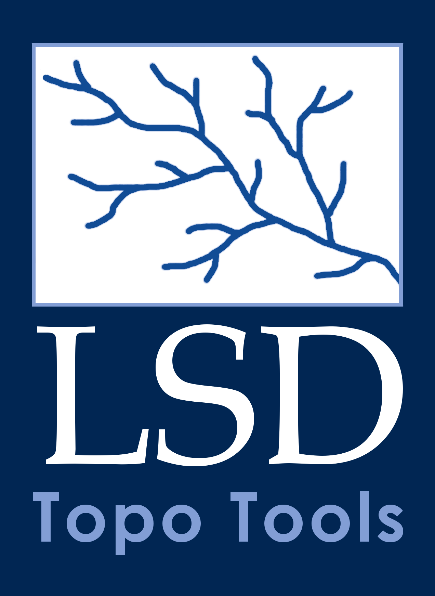

# lsdtt3



A redesign of [LSDTopoTools2](https://github.com/LSDtopotools/LSDTopoTools2) with a modern C++ architecture.

**Copyright:** Simon M. Mudd  
**Licence:** GPL-3.0  
**Additional developers:** Rutger Vervoordeldonk
**Additional authors of proted code:** Fiona Clubb, Stuart Grieve, David Milodowski, Boris Gailleton, Martin Hurst, Declan Valters 

---

## Overview

lsdtt3 is a C++ library and set of command-line tools for topographic analysis of digital elevation models (DEMs). It is a ground-up redesign of [LSDTopoTools2](https://github.com/LSDtopotools/LSDTopoTools2), retaining the core algorithms and scientific functionality while rebuilding the architecture for modern C++17, optional GPU support, and easier incremental development.

If you use this software for research, please also cite the original LSDTopoTools2:

> Mudd, S. M., Clubb, F. J., Grieve, S. W. D., Milodowski, D. T., Gailleton,
> B., Hurst, M. D., Valters, D. V., Wickert, A. D., & Hutton, E. W. H. (2023).
> LSDtopotools/LSDTopoTools2: LSDTopoTools2 v0.9. Zenodo.
> https://doi.org/10.5281/zenodo.8076231

**lsdtt3 is not backward-compatible with LSDTopoTools2.**

Key improvements over LSDTopoTools2:

- Reads any GDAL-supported format (GeoTIFF, COG, VRT, BIL, ASC, …). VRT is especially useful for large tiled datasets.
- Writes vector outputs (GeoPackage, FlatGeobuf, CSV) with correct georeferencing via GDAL/OGR.
- Automatic projection handling: If input data is not projected, converts to UTM below ±75°, polar stereographic at high latitude, optional Lambert LAEA for wide-extent rasters spanning more than two UTM zones.
- If input raster is projected, keeps the projection. So regional projections (e.g., British National Grid) can be retained for both input and output. Can also ingest projected coordinates from other planets (e.g., Mars or Titan)
- Cloud Optimised GeoTIFF (COG) output by default. Calculates internally time savings of COG format so small rasters are output as standard GeoTIFF.
- 64-bit pixel indexing — can process DEMs larger than 40,000 × 40,000 pixels. Elswhere data types are used to reduce memory consumption (8 bit, and 32 bit data used where approriate).
- D8 and DAG (D-infinity / MFD) flow routing. D8 uses the s-vector for O(1) upslope-set queries.
- CPU and GPU backends behind a shared abstract interface (GPU is a placeholder for now).
- Analysis routines as stateless free functions — editing one analysis file no longer triggers a full rebuild. Analyses are also clustered by task so (hopefully) it is easier to find the functions you want (although a side effect of this is that there are many more command line interfaces than previously). 
- OpenMP multithreading for selected routines; many operations are substantially faster than the equivalent LSDTopoTools2 code.
- Many algorithms made more robust and/or faster (e.g., Spectral analysis, proximity tools, metrics based on moving windows). 
- Overall, users should have more flexibility/ease for file I/O, should see less memory consumption (and as a result be able to process bigger datasets and have fewer segmentation faults), and should see speedup of a number of key algorithms.

LLM Usage:

Developers of `lsdtt3` have used various LLMs (GPT Codex 5.3, Claude Haiku, Sonnet, and Opus) and to port legacy code and write new routines, with testing against baselines (e.g., lsdtt2 outputs, previous iterations of algorithms) and regular code review. 

---

## Beta testing: quick install (Windows / WSL2)

`lsdtt3` is currently in private beta. 

Pre-built executables for Ubuntu 22.04 are attached to each [GitHub Release](../../releases/latest) as `lsdtt3-ubuntu-22.04.tar.gz`.

If you wish to test the latest development routines you will need to compile the code. 

Full explanations of these steps are in the `/docs` folder of this repository. 

### Step 1 - get a Linux terminal

On Windows, install WSL2 and Ubuntu 22.04 if you have not already done so:

1. Open PowerShell as administrator and run `wsl --install`.
2. Restart, then install **Ubuntu 22.04 LTS** from the Microsoft Store.
3. Launch Ubuntu and set a username and password when prompted.

For more details see the `/docs` directory of this repository. 

### Step 2a - install tagged versions of lsdtt3

Download `lsdtt3-ubuntu-22.04.tar.gz` from the Releases page (or from the
link the developer sent you) and run:

```bash
bash install.sh /mnt/c/Users/YourName/Desktop/lsdtt3-ubuntu-22.04.tar.gz
```

The installer installs the required system libraries, unpacks all the
command-line tools to `~/.local/lsdtt3/bin`, and adds them to your `PATH`.

### Step 2b

Compile (if you want the latest versions). See the `/docs` directory. 

### Step 3 — open a new terminal and verify

```bash
lsdtt-channel-extraction --help
```

If you see a list of parameters the installation succeeded.

### Reporting bugs

**WARNING** This is software built by academics for academic use within a research group. It is not supported commercial software. The developers are happy to help if you have questions, comments, bug reports etc, but keep in mind the developers may be working on other things (teaching, doing research, etc) and adjust expectations of response timescales accordingly. 

Please include:
- the exact command you ran
- the full terminal output (copy and paste)
- your Ubuntu version: `cat /etc/os-release | grep VERSION=`

**Full installation and troubleshooting notes:** `docs/beta_testing_notes.md`

---

## Dependencies

`lsdtt3` has more dependencies than `lsdtopotools2`. However all dependencies are stabile and easily installable on Linux (and by extension linux subsystems for Windows and MacOS). We also provide an apptainer container (although not frequently updated) that allows running of the softare without having to manage installation. 

| Dependency | Required | Enables |
|---|---|---|
| CMake ≥ 3.15 | Yes | Build system |
| C++17 compiler (GCC ≥ 9 or Clang ≥ 10) | Yes | All |
| GDAL ≥ 3.0 | Yes | All raster and vector I/O |
| OpenMP | No | Multi-core parallelism across most routines |
| FFTW3 (double precision) | No | `lsdtt-spectral-analysis`; wavelet quadratic polyfit in other tools |
| Eigen3 | No | `lsdtt-chi-analysis`; chi k_sn / u* inversion |
| OpenCV (core + imgproc) | No | Frangi filter, Otsu segmentation, Hough line extraction, adaptive thresholding in `lsdtt-surface-metrics` |
| NetCDF | No | ERA40 atmospheric / palaeomagnetic corrections in `lsdtt-cosmo-tool` and `lsdtt-cosmo-prediction` |
| CUDA toolkit | No | GPU compute backend (not yet implemented) |

### Ubuntu / Debian

```sh
# Required
sudo apt update
sudo apt install cmake build-essential libgdal-dev

# Optional — install whichever you need
sudo apt install libfftw3-dev        # spectral analysis, wavelet polyfit
sudo apt install libeigen3-dev       # chi analysis and k_sn inversion
sudo apt install libopencv-dev       # image analysis in surface metrics
sudo apt install libnetcdf-dev       # CRN palaeomagnetic corrections
```

OpenMP is included with GCC and needs no separate install.

### Windows (WSL2)

Run lsdtt3 inside a WSL2 Ubuntu environment and use the Ubuntu instructions above. See `docs/wsl2_notes.md` and `docs/lsdtt3_in_windows.md` for WSL2-specific setup notes.

### macOS

See `docs/lsdtt3_in_macos.md`. Apple Clang does not ship with OpenMP; the doc covers the Homebrew workaround.

### Apptainer container

A pre-configured Apptainer definition is provided that includes all dependencies (GDAL, FFTW3, Eigen3, OpenCV, OpenMP) on Ubuntu 22.04. See `apptainer_def/apptainer_setup.md` for setup on Linux, macOS, and Windows (WSL2).

### Debian packaging

See `docs/debian_packaging.md` for building a `.deb` package for distribution on Debian-based systems.

---

## Building

```sh
git clone https://github.com/LSDtopotools/lsdtt3.git
cd lsdtt3
mkdir build && cd build
cmake .. -DCMAKE_BUILD_TYPE=Release
make -j$(nproc)
```

Compiled executables are written to `build/`. To use them from any directory:

```sh
export PATH=/path/to/lsdtt3/build:$PATH
```

### CMake options

| Option | Default | Description |
|---|---|---|
| `CMAKE_BUILD_TYPE` | `Release` | `Release`, `Debug`, or `RelWithDebInfo` |
| `LSDTT_GPU` | `OFF` | Enable GPU compute backend (requires CUDA toolkit) |
| `LSDTT_OPENCV` | `ON` | Build OpenCV-dependent routines (auto-disabled if OpenCV not found) |
| `LSDTT_EIGEN` | `ON` | Build Eigen3-dependent routines (auto-disabled if Eigen3 not found) |

---

## Command-line programs

All programs take a plain-text parameter file as their argument. Parameter files use `key: value` syntax, one entry per line; lines beginning with `#` are comments. Pass `-h` to any program for a full parameter reference.


```sh
lsdtt-raster-preprocessing  my_params.driver
lsdtt-drainage-analysis     my_params.driver
```

**Detailed parameter references for each program are in `docs/`.**

### DEM preparation

| Program | Description | Reference |
|---|---|---|
| `lsdtt-raster-preprocessing` | Reprojects geographic/Web Mercator DEMs to UTM/polar, applies elevation threshold masking, fills interior nodata voids, clips to maximum valid rectangle, breaches depressions (Lindsay 2016/2020), fills pits (Barnes 2014), writes hillshade. | `docs/cli_reference_lsdtt_raster_preprocessing.md` |
| `lsdtt-raster-synthetic-tests` | Generates synthetic test surfaces (random, fractal, diamond-square, mountain-range geometries) for algorithm validation. | — |

### Surface analysis

| Program | Description | Reference |
|---|---|---|
| `lsdtt-surface-metrics` | Hillshade, local relief, polynomial surface fit (direct and wavelet), curvature metrics, MADk2 roughness, Frangi filter, Otsu segmentation, Hough line extraction, curvature skeletons, cloth-drape upper envelope and incision depth. | `docs/cli_reference_lsdtt_surface_metrics.md` |
| `lsdtt-flat-surface-finder` | Identifies low-texture surfaces (alluvial fans, terraces, piedmonts) using MADk2, residual IQR, and normal-vector dispersion (NVD). | — |
| `lsdtt-mountain-front` | Identifies mountain fronts from multi-scale relief, piedmont surface fitting, and residual thresholding. Supports synthetic DEM validation mode. | `docs/cli_reference_lsdtt_mountain_front.md` |
| `lsdtt-feature-finder` | Feature-detection workflows (terraces, piedmonts, hillslope morphology). | — |
| `lsdtt-spectral-analysis` *(requires FFTW3)* | Spectral surface analysis using the FFTW double API. | — |

### Flow routing and drainage

| Program | Description | Reference |
|---|---|---|
| `lsdtt-drainage-analysis` | Drainage area via D8, D-infinity, or MFD routing. Topographic Wetness Index (TWI). | `docs/cli_reference_lsdtt_drainage_analysis.md` |
| `lsdtt-channel-extraction` | D8 flow routing, contributing-pixel threshold source extraction, junction/channel network construction, network export to CSV / GeoPackage / FlatGeobuf. | `docs/cli_reference_lsdtt_channel_extraction.md` |
| `lsdtt-basin-extraction` | D8 flow routing, channel/junction network, junction-aware basin extraction. Writes basin outlines, raster labels, and statistics. | `docs/basin_extraction_guide.md` |
| `lsdtt-basin-stats` | Hydromorphic statistics for outlet-point-defined basins: elevation, slope, flow-distance percentiles; centroid; drainage area; channel length by Strahler order. | `docs/cli_reference_lsdtt_basin_stats.md` |
| `lsdtt-hydraulic-routing` | Graph-based hydraulic routing (Gailleton et al. 2024) on a fixed D-infinity or MFD flow graph. Writes water depth, water surface, and flux rasters. | — |
| `lsdtt-stream-burning` | Loads a polyline channel network, seeds D8 routing from its source tips, and writes the DEM-extracted network for comparison before burning. | — |

### Channel network analysis

| Program | Description | Reference |
|---|---|---|
| `lsdtt-channel-network-analysis` | Channel-link bearing fitting, junction-angle calculation (donor opening, bending angle), Strahler/Tokunaga self-similarity analysis. | `docs/cli_reference_lsdtt_channel_network_analysis.md` |
| `lsdtt-chi-analysis` *(requires Eigen3)* | End-to-end chi workflow: chi extraction, piecewise-linear network fitting, disorder metrics with jackknife/bootstrap uncertainty, spatial k_sn / u* inversion with m/n model selection. | `docs/cli_reference_lsdtt_chi_analysis.md` |
| `lsdtt-cross-sections` | Cross-section extraction along channel networks or user-defined transects. | `docs/cli_reference_lsdtt_cross_sections.md` |

### Tidal / marsh

| Program | Description | Reference |
|---|---|---|
| `lsdtt-marsh-topography` | Marsh platform identification, tidal channel extraction, skeleton-based channel metrics. | `docs/cli_reference_lsdtt_marsh_topography.md` |

### Cosmogenic nuclides

| Program | Description | Reference |
|---|---|---|
| `lsdtt-cosmo-tool` | Basin-averaged CRN erosion-rate inversion. Reads measured nuclide concentrations, computes Stone 2000 production, snaps points to D8 network, inverts via Newton-Raphson + bisection. Optional ERA40 / palaeomagnetic correction (requires NetCDF). | `docs/cli_reference_lsdtt_cosmo_tool.md` |
| `lsdtt-cosmo-prediction` | Predicts CRN concentrations across a DEM: steady-state, step-change transient, and erosion-weighted accumulated concentration. | `docs/cli_reference_lsdtt_cosmo_prediction.md` |
| `lsdtt-crn-column-tool` | 1-D transient cosmogenic nuclide column simulation. Steady-state, step-change, and full-transient (user-supplied erosion history) modes. No DEM required. | `docs/cli_reference_lsdtt_crn_column_tool.md` |

### Landscape evolution

| Program | Description |
|---|---|
| `lsdtt-lem` | Landscape evolution model: D-infinity flow routing, implicit stream-power fluvial incision (Anand et al. 2020 / Braun & Willett 2013), Cidre linear/nonlinear hillslope transport (Carretier et al. 2016), uniform uplift. Runs from a synthetic flat or noise surface, or an input DEM. |

### Utilities

| Program | Description |
|---|---|
| `lsdtt-linear-stats` | Statistical summaries for linear (directional/bearing) data. |

---

## Other Documentation

| Document | Contents |
|---|---|
| `docs/lsdtt3_architecture.md` | Full architecture reference: layer design, naming conventions, all module APIs. Start here for development. |
| `docs/developer_onboarding.md` | Getting-started guide for new contributors. |
| `docs/backend_abstraction_rules.md` | When to use abstract bases + factories vs. concrete CPU free functions. |
| `docs/using_lsdtt_flowinfo.md` | How to use the D8 flow routing object in analysis code. |
| `docs/lsdtt_utils_guide.md` | Guide to the `src/utils/` layer: what belongs there and the valid-data contract. |
| `docs/basin_extraction_guide.md` | Basin extraction workflow in detail. |
| `docs/cli_reference_lsdtt_channel_extraction.md` | Channel network extraction: parameters, output formats, stream burning. |
| `docs/cli_reference_lsdtt_basin_stats.md` | Basin statistics: outlet CSV format, snapping, output columns. |
| `docs/cli_reference_lsdtt_chi_analysis.md` | Chi analysis: m/n sweep, disorder metrics, bootstrap, k_sn inversion. |
| `docs/cli_reference_lsdtt_cosmo_prediction.md` | CRN prediction: steady-state, step-change, accumulated concentration. |
| `docs/beta_testing_notes.md` | Beta tester install guide (WSL2), release pipeline, and future conda-forge plan. |
| `docs/installing_locally.md` | Local installation notes. |
| `docs/lsdtt3_in_windows.md` | Windows (WSL2) setup. |
| `docs/wsl2_notes.md` | WSL2-specific notes. |
| `docs/lsdtt3_in_macos.md` | macOS setup including OpenMP workaround. |
| `docs/debian_packaging.md` | Building a Debian package. |
| `apptainer_def/apptainer_setup.md` | Apptainer container setup. |

---

## Python helpers

We also provide various python helpers (in `python_helpers/`) for simple visualisation and downloading of DEMs. Maintaining python environments is very time consuming and annoying, which is why the core tools are written in c++. We provide helper functions for users familiar with maintaining a geospatial python environment, but if you don't know how to do this just use a GIS and the internet to get and look at `lsdtt3` data inputs and outputs.  

## References

Mudd, S. M., et al. (2023). LSDtopotools/LSDTopoTools2 v0.9. Zenodo. https://doi.org/10.5281/zenodo.8076231

Barnes, R., Lehman, C., Mulla, D. (2014) Priority-flood: An optimal depression-filling and watershed-labeling algorithm for digital elevation models. *Computers & Geosciences*, 62, 117–127.

Gailleton, B., et al. (2024) Graph-based hydrodynamic modelling. *(see lsdtt-hydraulic-routing)*

Lindsay, J.B. (2016) Efficient hybrid breaching-filling sink removal methods for flow path enforcement in digital elevation models. *Hydrological Processes*, 30(6), 846–857.

Lindsay, J.B. (2020) Pit-centric depression removal methods. *Geomorphometry 2020 Conference Proceedings*.

Stone, J.O. (2000) Air pressure and cosmogenic isotope production. *Journal of Geophysical Research*, 105(B10), 23753–23759.

Tarboton, D.G. (1997) A new method for the determination of flow directions and upslope areas in grid digital elevation models. *Water Resources Research*, 33(2), 309–319.

Zhang, W., et al. (2016) An easy-to-use airborne LiDAR data filtering method based on cloth simulation. *Remote Sensing*, 8(6), 501.

Zevenbergen, L.W. and Thorne, C.R. (1987) Quantitative analysis of land surface topography. *Earth Surface Processes and Landforms*, 12, 47–56.
