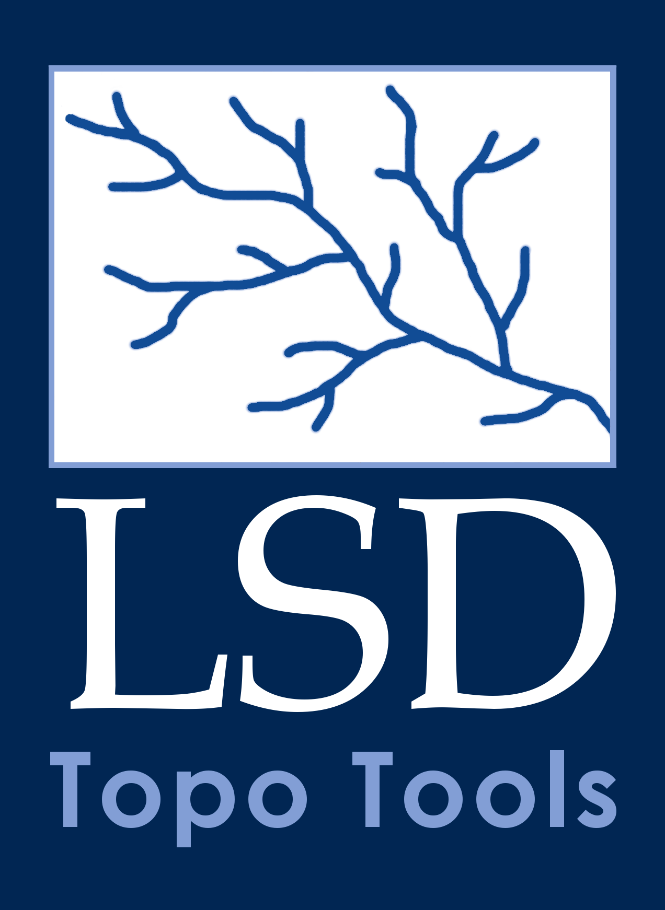

# LSDTopoTools3

  

**LSDTopoTools3** (lsdtt3) is a C++17 library and set of command-line tools for topographic analysis of digital elevation models (DEMs). It also includes two basic landscape evolution models (lems, once is minimalistic, one has a few extra bells and whistles), tools for analysis of cosmogenic radionuclides (CRNs), a simple flooding model and two hydrologic models, and tools for downloading both DEMs and lithologic data. It is a ground-up redesign of [LSDTopoTools2](https://github.com/LSDtopotools/LSDTopoTools2), with faster algorithms and performance enhancements, built-in handling of a wide range of raster and vector data formats, python bindings and an API, a QGIS plugin, and a rigorous testing regime that includes benchmarking against similar software packages. Basically it improves every component of LSDTopoTools2. We hope you like it!

---

## Quick links

| I want to… | Go to |
|---|---|
| Understand what lsdtt3 does | [Overview](what_is_lsdtt3/overview.md) |
| **Install lsdtt3** | [Installation](what_is_lsdtt3/install_lsdtt3.md) — Linux, Windows, macOS, Colab |
| Install on Windows | [Windows via WSL2](what_is_lsdtt3/install_lsdtt3.md#windows-via-wsl2) |
| Install on macOS | [macOS](what_is_lsdtt3/install_lsdtt3.md#macos) |
| Run it in a browser | [Google Colab](what_is_lsdtt3/install_lsdtt3.md#google-colab) |
| Look up parameters for a tool | [Command-line reference](cli_reference/cli_reference_lsdtt_channel_extraction.md) |
| Compile the latest code (DO NOT do this unless you are a developer) | [Building from source](developer_notes/building_from_source.md) |
| Contribute or modify the code | [Developer notes](developer_notes/developer_onboarding.md) |

---

## Some of the capabilities at a glance

**DEM preparation** — reproject, fill, breach depressions, clip to valid extent.

**Surface analysis** — hillshade, curvature, roughness, local relief, Frangi filter, cloth-drape incision depth.

**Flow routing** — D8, D-infinity, and MFD routing; topographic wetness index; 64-bit pixel indexing for very large DEMs.

**Channel networks** — channel extraction, junction networks, Strahler ordering; export to CSV, GeoPackage, or FlatGeobuf.

**Basin analysis** — basin delineation, hydromorphic statistics, chi analysis and k_sn inversion.

**Cosmogenic nuclides** — basin-averaged CRN erosion rates, concentration prediction, 1-D transient column simulation.

**Landscape evolution** — implicit stream-power incision, linear and nonlinear hillslope transport, uniform uplift, and more exotic configurations.

---

## Citing lsdtt3

If you use lsdtt3 in research, please cite it:

> Mudd, S. M., Vervoordeldonk, R., Gailleton, B., Hawksworth, M. E., Clubb, F. J., Grieve, S. W. D., Milodowski, D. T., Valters, D., & Hurst, M. D. (2026). LSDTopoTools3 (lsdtt3): topographic analysis for geomorphology. Zenodo. [https://doi.org/10.5281/zenodo.24110423](https://doi.org/10.5281/zenodo.24110423)

Please also cite the original LSDTopoTools2:

> Mudd, S. M., Clubb, F. J., Grieve, S. W. D., Milodowski, D. T., Gailleton, B., Hurst, M. D., Valters, D. V., Wickert, A. D., & Hutton, E. W. H. (2023). LSDtopotools/LSDTopoTools2: LSDTopoTools2 v0.9. Zenodo. [https://doi.org/10.5281/zenodo.8076231](https://doi.org/10.5281/zenodo.8076231)

**Copyright:** Simon M. Mudd | **Licence:** AGPL-3.0-or-later
